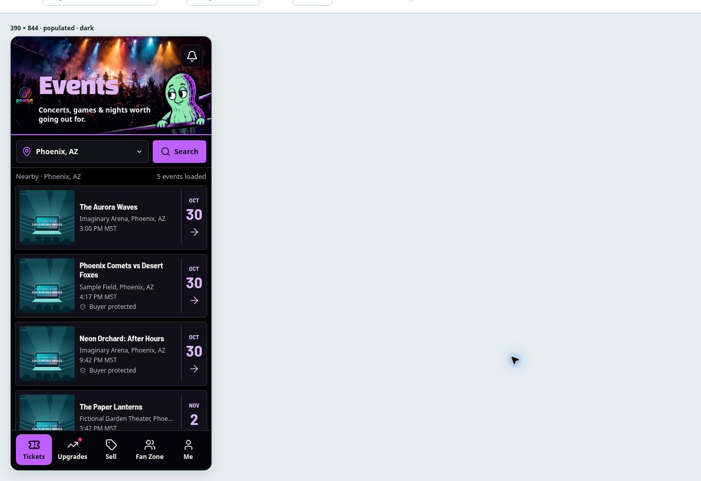
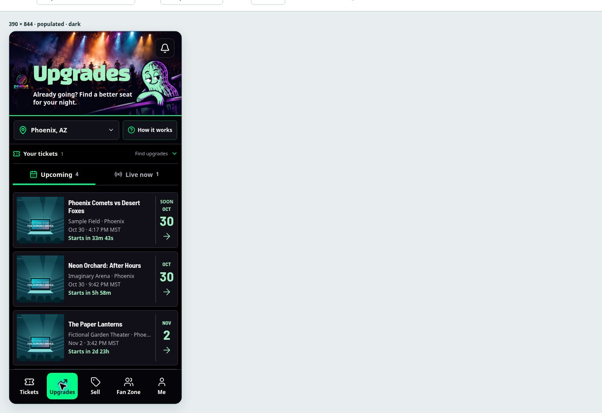

# Events and Upgrades — gallery mascot refresh

Implements the two selected October 30 concepts in the existing React screens. The headers combine locally served concert/peanut illustrations with live HTML headings, logo, notification link, location picker, search, and upgrade explanation controls. Event rows use matte surfaces and a solid date separator, with violet for Events and mint for Upgrades. Ticket perforations and printed textures are removed from these two browse lists only.

The existing discovery queries, event imagery, real venue dates, countdowns, ownership panel, search filters, pagination, live/upcoming switching, return navigation, and loading/error/empty states are preserved. Screenshot sample events and dates are not production data. This branch does not change backend functions, payment flows, or deploy configuration.

## Validation

- Production `npm run build` passed. The checkout has no deployment environment: Vite reports the existing missing `VITE_BASE44_APP_ID` warning. Production builds still require the project's usual Base44 environment.
- 71 existing focused tests passed across `upgrade-discovery`, `upgrades-owned-navigation`, `upgrades-live-discovery`, `oct09-discovery-state`, `oct09-discovery-paging`, `event-discovery-paging`, `discovery-notification-visibility`, `browse-ticket-interaction`, and `event-date-display`.
- ESLint passed for the three modified JSX files. `git diff --check` passed.
- Managed local preview used the isolated fixture with fictional data and no real backend. Inspected 320/390/430px Events in light mode, 390px Events in dark mode, 320/390px Upgrades in dark mode, and 320/390/430px Upgrades empty state in light mode. Confirmed no horizontal overflow on the measured browse pages/rows and successful local font loading.
- Exercised Events search panel/submission and location editor, bottom navigation, Upcoming/Live now switching, live event hub navigation and return to Live now, and the upgrade explanation modal. Inspected provider-error messaging and retry controls at 320px.
- Independent diff review found one CSS order issue; the Upgrades page padding selector now outranks its lazy-loaded stylesheet. A React 18 image-prop warning found in browser review was removed.

Native iPhone safe-area behavior and production authenticated/provider traffic were not exercised. Existing isolated browser runners can still load the six exact local assets; other network restrictions remain intact.

## Preview locally

```sh
npm ci
./node_modules/.bin/vite --config tests/fixtures/ticket-design/vite.config.mjs
```

Open `/tests/fixtures/ticket-design/?page=events&width=390&theme=dark` on the local Vite URL. Switch `page=upgrades`, `width=320|430`, `theme=light`, or `scenario=empty|provider-error` for the other states. The fixture host allowlist also supports the managed `terminal.local` preview hostname. Production `dev` and `build` scripts are unchanged.

## Rendered evidence

These are actual 390 × 844 CSS-pixel React renders using fictional fixture data, not the concept screenshots. The optional existing owned-ticket panel is shown on Upgrades because the fixture includes a ticket.





## Assets

- `public/images/discovery/*-gallery-hero.webp`: clean 1600 × 800 background plates edited from the two user-selected concepts with imagegen. Each retains its selected peanut pose; no text, logo, bell, or other UI is baked in. WebP output is approximately 119–130 KiB per plate.
- `public/images/brand/peanut-gallery.png`: unchanged bytes of the existing PG logo previously served by Base44, now local.
- `public/fonts/discovery/`: Black Han Sans, DM Sans, and Barlow Semi Condensed subsets from Fontsource, with their OFL licenses. Local names scope these type choices to the browse refresh.

No npm dependencies were added. Reverting this change restores the previous browse appearance without a data migration.
