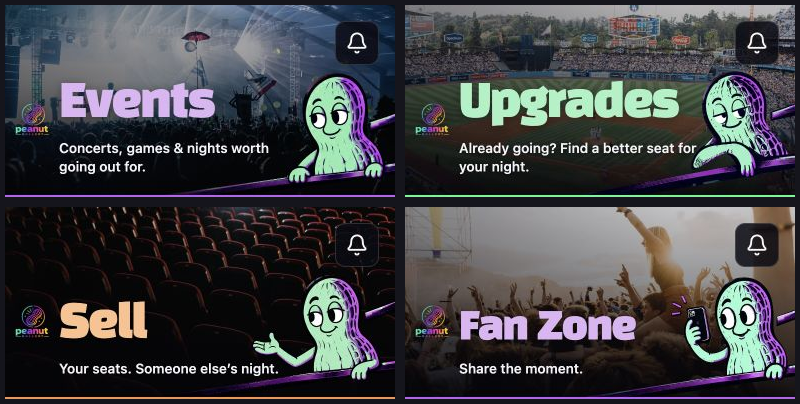

# Distinct real photographs for the primary pages

Events, Upgrades, Sell, and Fan Zone previously reused one concert photograph. Each now has a different local image and its own crop: a blue-lit festival, a baseball stadium, red theater seats, and a sunset crowd. Me retains the existing concert photo, so all five primary pages have different backgrounds.

The approved PG characters, headings, controls, layout, and page accents are preserved. Photographer credits and original sources are recorded in [SOURCES.md](../../../public/images/discovery/SOURCES.md). No new generated imagery is used.

## Validation

- Local and Base44 production builds passed.
- ESLint passed for `src/components/Layout.jsx`; `git diff --check` passed.
- All 27 existing checks passed across `browse-ticket-interaction`, `ui-control-contrast`, and `public-access-render`.
- Reviewed all four changed pages at 390 × 844 in the isolated browser fixture. All four photos and mascot layers loaded, with no horizontal document overflow.
- Also reviewed Upgrades and Fan Zone at 320 pixels wide, and Me at 430 pixels wide.
- Browser review uses fictional accounts and event records; this is not a live transaction test or a new native TestFlight build.

## Header comparison

These are the top 192 pixels of the actual browser captures below, arranged for comparison.

## Full phone captures

- [Events](events-390.png)
- [Upgrades](upgrades-390.png)
- [Sell](sell-390.png)
- [Fan Zone](fan-zone-390.png)
