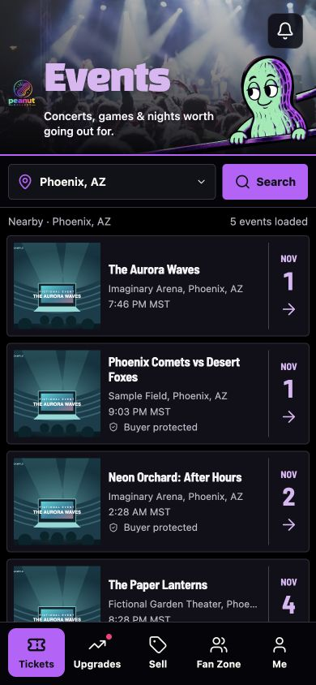

# Real photography for the five primary headers

Replaces the generated concert scenes on Events, Upgrades, Sell, Fan Zone, and Me with one locally served, documented concert photograph. The approved peanut poses and illustrated rail are separate transparent assets; headings, navigation, accent colors, and layout stay live and unchanged.

The five former composite files are removed from the served app. The photographic background, CSS readability shade, and character layer can now be replaced independently. [Asset provenance](../../../public/images/discovery/SOURCES.md) records the photographer, original photo, license, and the existing character artwork's origin.

## Checks

- `npm run build` passed locally and in the Base44 branch.
- ESLint passed for `src/components/Layout.jsx`; `git diff --check` passed.
- 27 existing tests passed across `browse-ticket-interaction`, `ui-control-contrast`, and `public-access-render`.
- Browser review used the existing isolated fixture with fictional accounts/events. Inspected all five page headers across 320, 390, and 430 CSS-pixel widths. Fixed the photo shade's stacking context so it cannot cover the live headings or logo.
- This is visual/browser validation, not a new physical-device TestFlight build or a live transaction test.

## Events at 390 × 844

The event list below is fictional fixture data. The header uses the production photo and character assets.

