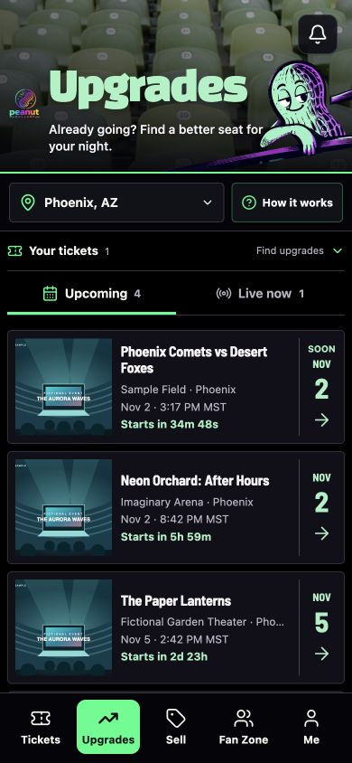

# Upgrades photo replacement

Replaced the Dodger Stadium header with a close-up photograph of empty green seats by Van Anh Nguyen. The inspected source has no visible people, team marks, sponsor signs, or venue name. The old stadium asset is removed from `public/images/discovery`; the mascot, typography, controls, and layout are unchanged. [Source and license record](../../../public/images/discovery/SOURCES.md).

Based on GitHub commit `885778b2a0e942bff4ba87aa0c11c4ed46464f7b`, preserving the user's newer Fan Zone styling.

Validation: local and Base44 production builds passed; ESLint and `git diff --check` passed; 13 existing browse interaction tests passed. Browser review confirmed the new photograph and mascot load at 390 pixels wide with no horizontal overflow. The screenshot uses the isolated fixture's fictional account and events, not live customer data.

